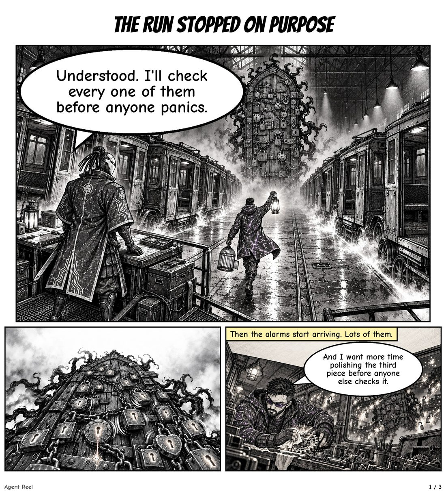
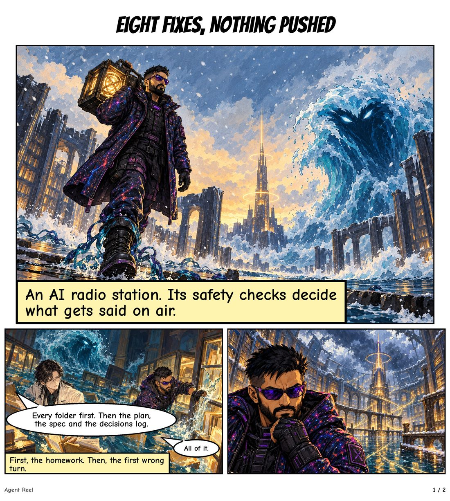
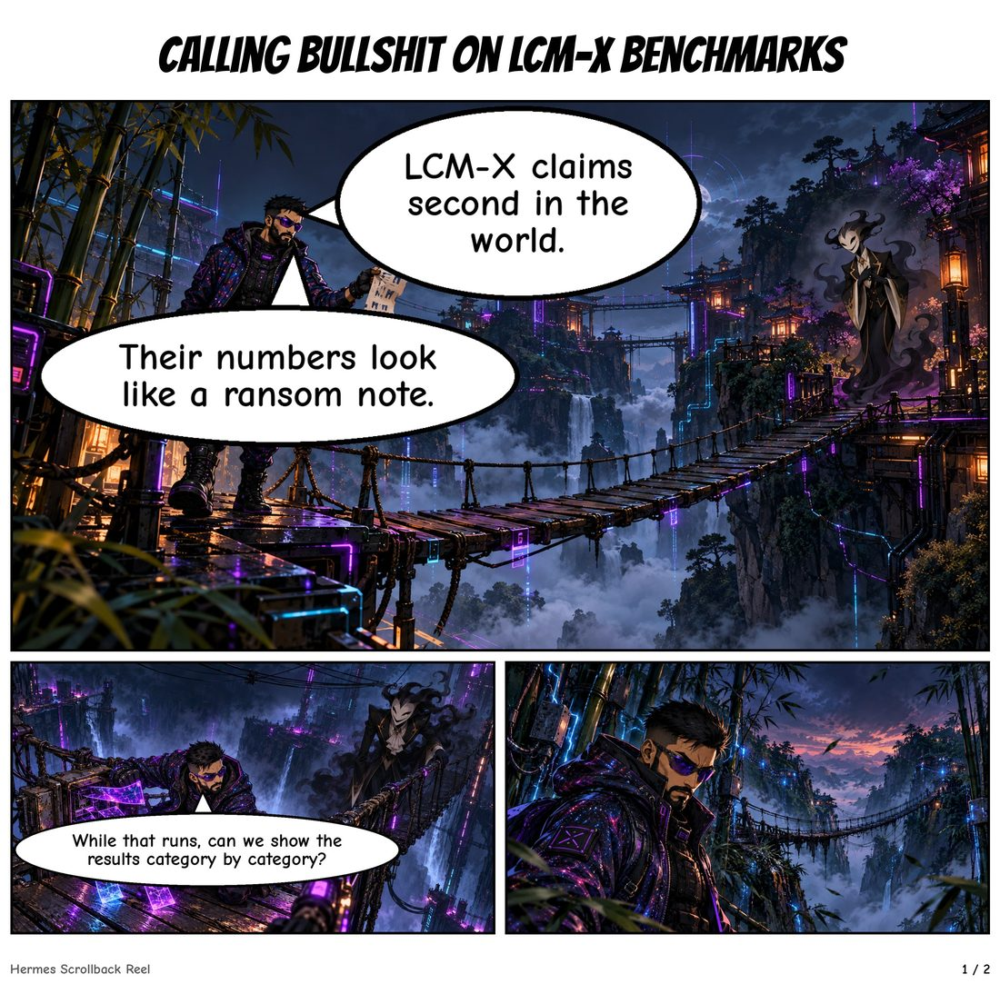

# Agent Reel

Turn your AI agent's real history into an illustrated story. Not a summary, not a dashboard:
pick **any session, day, week or month**, pick a **format** — a four-panel comic strip, a
manga chapter, a picture storybook — and it draws what actually happened, where every line
traces back to a real message on your machine.

```
# one session, one strip
hermes reel plan   --since 2026-10-24 --until 2026-10-25 --episodes 1 --panels 4
hermes reel render --plan-dir <data-dir> --episode 1 --style ink-pen-sketch

# a month, as a manga chapter per story
hermes reel plan   --days 30 --episodes 3 --format chapter
```

## See it

Three real pages, drawn from the author's own history, in three of the 55 styles. Four story
panels each, plus wordless filler panels the way a printed comic has them. The words are what
actually happened; the pictures are the licence the tool takes with them.

| Ink and crosshatch | Painted storybook | Cyberpunk HUD |
|---|---|---|
|  |  |  |
| "The Run Stopped On Purpose" | "Eight Fixes, Nothing Pushed" | "Calling Bullshit on LCM-X Benchmarks" |

Each of those came from a different session, with a different cast: a background run that
looked dead because it had been killed deliberately; eight rounds of review fixes that were
ready and not pushed; a rival's benchmark numbers. Every line in the script carries the id of
the message that states it, and the villain, world and art style are drawn per chapter.

These are unretouched renderer output, not retouched marketing art: a panel can come back
with a flaw, and the run reports it rather than hiding it.

## What it does

- **Reads your own history.** Hermes sessions, tool calls and kanban cards become events.
  Nothing reaches a model until it has passed the redaction gate.
- **Finds a story, not a log.** It looks for work with a problem, a struggle and a result,
  then writes a synopsis, a scene-by-scene script, an editor pass and one rewrite — in
  plain English, with names and numbers kept exact.
- **Cites everything.** Every line and caption carries the ids of the messages that state
  it. A line that cites nothing it says is refused, not printed.
- **Never tells the same story twice.** A series ledger remembers what each chapter told,
  carries one open thread into the next chapter, and refuses repeats.
- **Draws it with your model.** 55 art styles, character sheets, comic page layout, speech
  balloons with tails to the speaker, and export sizes for X, LinkedIn and Discord — using
  the image model you already have.

## Requirements

- Hermes Agent with the plugin CLI (this plugin registers one command: `hermes reel`).
- Python package `pillow` (declared in the manifest; the host installs it).
- An image model. Four routes — see **Image sources** below.

## Install

```bash
hermes plugins install Sahil-SS9/hermes-agent-reel
hermes plugins enable agent-reel
hermes reel plan --dry-run --days 7 --episodes 1 --format chapter
```

Nothing runs on a schedule unless you create one. The plugin registers no hooks and no
tools: one CLI command, nothing touching your live sessions.

## Formats

| Format | What you get | Shape |
|---|---|---|
| `--panels 4` | a four-panel strip, the social shape | one image, beginning → fight → result |
| strip (default) | six-panel strip | one image |
| `--format chapter` | multi-page chapter, 13-24 panels with wordless filler panels | pages + PDF |
| `book --month` | a monthly book from existing chapters | cover, contents, every episode |

Format and art style are independent: the same story works as a woodblock folktale, a
black-and-white manga page, a painted storybook or a cyberpunk strip. 55 styles ship, from
sumi-e and ukiyo-e to risograph, stained glass and blueprint.

## Commands

| Command | What it does |
|---|---|
| `hermes reel plan` | Pick the story, write the script, keep the trace. |
| `hermes reel render` | Draw one episode into pages, panels, share sizes and a PDF. |
| `hermes reel book` | Build a monthly book from existing renders. |
| `hermes reel styles` | List the 55 styles; `--set` a default; add your own. |
| `hermes reel sources` | List image sources; `--check` one without spending; `--set` a default. |
| `hermes reel kit` | Create a character sheet, or import the Hermes Multiverse set. |
| `hermes reel tones` | Tone: witty, comical, serious, quirky, epic, wholesome, noir — or a blend. |

## Image sources

| Source | What it is | Requires |
|---|---|---|
| `host` | Your harness's own image tool — whatever provider your Hermes already uses | nothing extra |
| `comfyui` | A local ComfyUI server: free, your GPU | ComfyUI on `127.0.0.1:8188` with an API-format workflow |
| `openai` | GPT Image via the OpenAI Images API | `OPENAI_API_KEY` |
| `gemini` | Nano Banana via the Gemini API | `GEMINI_API_KEY` |
| `fal` | FLUX or Nano Banana via fal.ai | `FAL_KEY` |

```bash
hermes reel sources --set comfyui
hermes reel sources --check comfyui      # one real request, no batch
```

**On other harnesses.** This plugin speaks to Hermes. Porting the approach elsewhere comes
down to one function: given a prompt, reference images and an aspect ratio, return a PNG
path. `canon/providers.py` holds the four implementations — copy the shape, point it at
whatever image model your harness exposes, and register it as a source. Details in
`docs/IMAGE-SOURCES.md`.

## Other agents

`hermes reel plan --harness claude-code,codex,opencode,pi,jsonl` reads other agents' local
logs read-only, alone or alongside Hermes.

- `claude-code`, `codex`, `opencode` have built-in readers.
- `jsonl` covers anything that writes JSON lines, described by a small mapping:

```json
{
  "name": "my-agent",
  "glob": "~/.my-agent/sessions/*/*.jsonl",
  "role": "message.role",
  "text": "message.content",
  "timestamp": "timestamp",
  "session": "sessionId",
  "thread": "cwd"
}
```

`thread` matters: a log file is a session, but a story needs a *thread* — the work the
chapter is about. Without it, a harness that starts a session per invocation produces
thousands of three-message threads and no story can form. Claude Code groups by project
folder automatically.

Tested on real logs: Claude Code (a real 6-panel episode), and `jsonl` with the mapping
above. Codex and Pi are read-only tested but this machine's corpora are too thin to form a
story — stated here rather than claimed as working.

## Styles

55 built-in styles in `styles/`, from clear-line and sumi-e to risograph, ukiyo-e, stained
glass and blueprint. Two are marked **tested** (anime, ink-pen-sketch); the other 53 are
**experimental** and the render refuses them unless you opt in — nothing claims to be
proven before it is.

Add your own: `<data-dir>/styles/my-style/style.md` with YAML front matter and a prompt
containing the line `**[INSERT CHARACTERS, ACTION AND SCENE HERE]**`. See `docs/STYLES.md`.

## Characters and consent

- Characters come from kits; `kits/kensei` and `kits/the-orphans` ship with the repo.
- `hermes reel kit import-multiverse` pulls the community Hermes Multiverse set,
  checksum-verified, and skips anything documentation-only or awaiting its creator's
  approval.
- Public mode refuses any real person without a consent record. Photo likeness is allowed
  only for yourself.

## Privacy

- History is read-only: no file is created, renamed, truncated or deleted under `~/.hermes`
  while the tool reads it (only normal SQLite read-locking touches an existing WAL index).
  `scripts/readonly_proof.sh` proves this with strace.
- Redaction runs before any model sees text: a deterministic pass plus a model pass that
  masks secrets, credentials, paths and personal data.
- Every line keeps its source ids, so any claim can be audited back to the message.
- No auto-posting. The tool writes files; you decide what to publish.

## What this reads and sends

Disclosure, for anyone deciding whether to install it:

- **Reads** your own Hermes history read-only: sessions, messages, tool calls, kanban cards.
  Redaction runs before any model sees text.
- **Sends** text to your Hermes model (`ctx.llm`) for the writing, the editor pass and the
  meaning checks, and panel images to the image route you choose. With `host`, that is your
  harness's own image provider; with `comfyui`, a local server on your machine; with
  `openai`/`gemini`/`fal`, that vendor's API using a key Hermes holds.
- **Stores** its plans, renders, series ledger and character kits under the plugin's data
  directory. Nothing is posted anywhere, and there is no telemetry.
- **Credentials** are read through Hermes (`agent.secret_scope`), never from files, and no
  key is required at all for the `host` or `comfyui` routes.

## Licence

MIT for code and prompt text. Bundled fonts are SIL OFL 1.1 — see `assets/fonts/FONTS.md`.

## Contributing

Issues and pull requests welcome. `pytest` runs the suite. For build-side documentation —
architecture, decisions, stage reports — start at `docs/HANDOFF.md`; the original build
README is kept at `docs/BUILD-README-original.md`.
