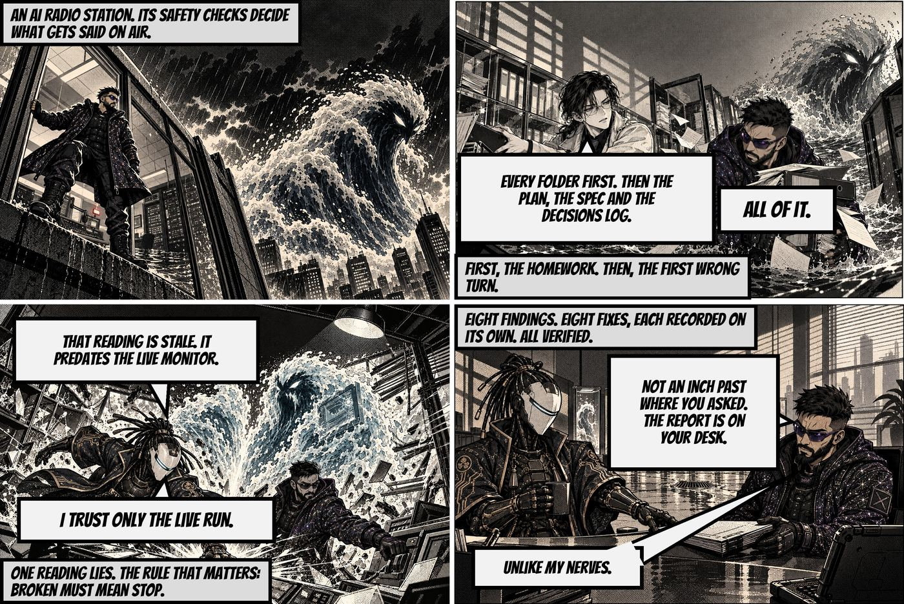
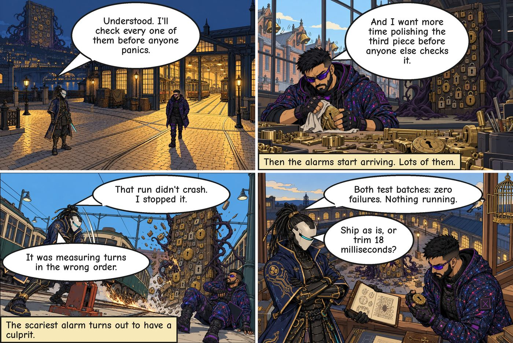

# Agent Reel

Turn your agent's real history into a comic. Not a summary, not a dashboard: pick **any
session, day, week or month**, pick a **format** — a four-panel strip, a manga chapter, a
picture storybook — and it draws what actually happened, with every line traceable to a real
message on your machine.

Works with the agent you already run and the image model you already have.

```
# one session, one strip
hermes reel plan   --since 2026-10-24 --until 2026-10-25 --episodes 1 --panels 4 --no-fillers
hermes reel render --plan-dir <data-dir> --episode 1 --style ink-pen-sketch

# a month, as a manga chapter per story
hermes reel plan   --days 30 --episodes 3 --format chapter
```

## See it

Four panels each, drawn from the author's own history. Same week, three of the 55 styles.

| Ink and crosshatch | Halftone noir | Clear line |
|---|---|---|
|  |  |  |
| "The Run Stopped On Purpose" | "Eight Fixes, Nothing Pushed" | "The Run Stopped On Purpose" |

Two stories, three looks: on the right, the same panels are restyled, which is the point —
format and art style are independent. The villain, the world and the style are drawn per
chapter, and every line in the script carries the id of the message that states it.

## Why it reads like a story and not a log

- **It picks the work that has a shape** — a problem, a struggle, a result — then writes a
  synopsis, a scene-by-scene script, an editor pass and one rewrite.
- **The dialogue is yours.** Where a real message already says the thing, the comic uses those
  words. Where it doesn't, the caption interprets what happened instead of inventing events.
- **Nothing is said that can't be sourced.** Every line and caption cites the messages that
  state it. A line that cites nothing it says is refused, not printed, and names and numbers
  stay exact through every rewrite.
- **It doesn't repeat itself.** A series ledger remembers what each chapter told, carries one
  open thread into the next, and refuses a repeat or a near-identical title.
- **The art changes with the story.** Each style owns its world, composition, impact frame and
  lettering — panel shape, balloon style, ink and font. A contrast test fails if two styles
  start to look the same, so they cannot quietly converge.

## Works with your harness

Agent Reel is harness-agnostic by design. The story engine never asks which agent wrote the
log; it reads a common event model, and one small adapter per harness fills it.

| Harness | Read from | How |
|---|---|---|
| Hermes Agent | `~/.hermes` | sessions, messages, tool calls, kanban cards |
| Claude Code | `~/.claude/projects` | project folders become threads automatically |
| OpenAI Codex CLI | `~/.codex/sessions` | built-in reader |
| OpenCode | `~/.local/share/opencode` | session, message and part tables only |
| Pi | `~/.pi/agent/sessions` | built-in reader |
| Anything else | your own logs | a small JSON mapping file, no code |

```bash
hermes reel plan --harness claude-code,codex --days 14 --episodes 2
```

Adding a harness is a mapping, not a fork:

```json
{
  "glob": "~/.my-agent/sessions/**/*.jsonl",
  "role": "message.role",
  "text": "message.content",
  "timestamp": "timestamp",
  "session": "sessionId",
  "thread": "cwd",
  "user_roles": ["user"],
  "assistant_roles": ["assistant"]
}
```

`thread` is the one field worth understanding. A log file is a session, but a story needs a
*thread* — the piece of work the chapter is about. A harness that starts a session per
invocation otherwise produces thousands of three-message threads and no story can form.
Claude Code groups by project folder without you doing anything.

## Works with your image model

Five routes, one contract: given a prompt, reference images and an aspect ratio, return a PNG.

| Source | What it is | Requires |
|---|---|---|
| `host` | Your harness's own image tool — whatever your provider already is | nothing extra |
| `comfyui` | A local ComfyUI server: free, your GPU | ComfyUI on `127.0.0.1:8188` with an API-format workflow |
| `openai` | GPT Image via the OpenAI Images API | `OPENAI_API_KEY` |
| `gemini` | Nano Banana via the Gemini API | `GEMINI_API_KEY` |
| `fal` | FLUX or Nano Banana via fal.ai | `FAL_KEY` |

```bash
hermes reel sources --set comfyui
hermes reel sources --check comfyui      # one real request, no batch
```

On another harness, porting the image side is one function: `canon/providers.py` holds the
five implementations — copy the shape, point it at whatever your harness exposes, register it
as a source. Details in `docs/IMAGE-SOURCES.md`.

## Formats

| Format | What you get | Shape |
|---|---|---|
| `--panels 4` | a four-panel strip, the social shape | one image, beginning → fight → result |
| strip (default) | six-panel strip | one image |
| `--format chapter` | multi-page chapter, 16 panels or more | pages + PDF |
| `book --month` | a monthly book from existing chapters | cover, contents, every episode |

Add `--no-fillers` to render story panels only, with no wordless filler panels between them.
Format and art style are independent: the same story works as a woodblock folktale, a
black-and-white manga page, a painted storybook or a cyberpunk strip.

## Styles

55 styles ship in `styles/`, from clear-line and sumi-e to risograph, ukiyo-e, stained glass and
blueprint. Three carry a full art direction of their own — `ligne-claire`, `halftone-noir` and
`risograph-print` — each with its own world, composition, impact frame and lettering, held
apart by a contrast test.

Two styles carry a recorded bake-off and are marked as such. `--strict-styles` limits a render
to those; without it, all 55 are available.

```bash
hermes reel styles                 # list them
hermes reel styles --set risograph-print
```

Add your own: `<data-dir>/styles/my-style/style.md`, YAML front matter plus a prompt containing
the line `**[INSERT CHARACTERS, ACTION AND SCENE HERE]**`. See `docs/STYLES.md`.

## Commands

| Command | What it does |
|---|---|
| `hermes reel plan` | Pick the story, write the script, keep the trace. |
| `hermes reel render` | Draw one episode into pages, panels, share sizes and a PDF. |
| `hermes reel book` | Build a monthly book from existing renders. |
| `hermes reel styles` | List the styles; `--set` a default; show one's raw prompt. |
| `hermes reel sources` | List image sources; `--check` one without spending; `--set` a default. |
| `hermes reel kit` | Create a character sheet, or import the Hermes Multiverse set. |
| `hermes reel tones` | Tone: witty, comical, serious, quirky, epic, wholesome, noir — or a blend. |

## Install

```bash
hermes plugins install Sahil-SS9/agent-reel
hermes plugins enable agent-reel
hermes reel plan --dry-run --days 7 --episodes 1 --format chapter
```

Requires Hermes Agent 0.21.5 or newer and `pillow`. Nothing runs on a schedule unless you
create one, and the plugin registers no hooks and no tools: one CLI command, nothing touching
your live sessions.

## Characters and consent

- Characters come from kits; `kits/kensei` and `kits/the-orphans` ship with the repo.
- `hermes reel kit import-multiverse` pulls the community Hermes Multiverse set,
  checksum-verified, and skips anything documentation-only or awaiting its creator's approval.
- Public mode refuses any real person without a consent record. Photo likeness is allowed only
  for yourself.

## Privacy

- **Reads** your own history read-only: no file is created, renamed, truncated or deleted under
  `~/.hermes` while the tool reads it (only normal SQLite read-locking touches an existing WAL
  index). `scripts/readonly_proof.sh` proves this with strace.
- **Redaction runs before any model sees text** — a deterministic pass plus a model pass that
  masks secrets, credentials, paths and personal data.
- **Sends** text to your model for the writing, the editor pass and the meaning checks, and
  panel images to the image route you choose. With `host` that is your own provider; with
  `comfyui`, a local server on your machine; with `openai`, `gemini` or `fal`, that vendor's API
  using a key Hermes holds.
- **Stores** plans, renders, the series ledger and character kits under the plugin's data
  directory. Nothing is posted anywhere. There is no telemetry.
- **Credentials** are read through Hermes (`agent.secret_scope`), never from files, and no key
  is needed at all for `host` or `comfyui`.

## Licence

MIT for code and prompt text. Bundled fonts are SIL OFL 1.1 — see `assets/fonts/FONTS.md`.

## Contributing

Issues and pull requests welcome. `pytest` runs the suite. For build-side documentation —
architecture, decisions, stage reports — start at `docs/HANDOFF.md`; the original build README
is kept at `docs/BUILD-README-original.md`.
